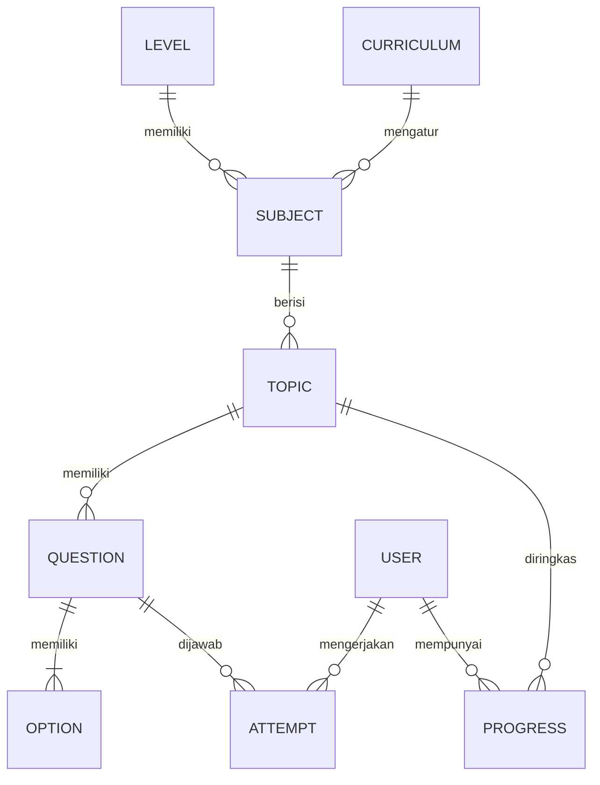

# Rancangan database

Skema relasional target untuk tahap PostgreSQL:

## Tabel target
- `levels`: TK, SD, SMP, SMA.
- `curricula`: nama dan versi kurikulum.
- `subjects`: mapel pada jenjang dan kurikulum tertentu.
- `topics`: materi dalam mapel.
- `questions`: teks soal, status draft/review/published, tingkat kesulitan.
- `options`: empat opsi pilihan ganda.
- `users`: profil minimal dan role siswa/guru/admin.
- `attempts`: jawaban, benar/salah, waktu, dan sesi.
- `progress`: ringkasan perkembangan siswa.
- `audit_logs`: catatan perubahan konten penting.

Setiap materi yang diterbitkan harus memiliki 50 soal valid sesuai kombinasi jenjang, kelas, mapel, materi, dan kurikulum. Jangan menganggap contoh data dalam starter sebagai konten kurikulum lengkap.
