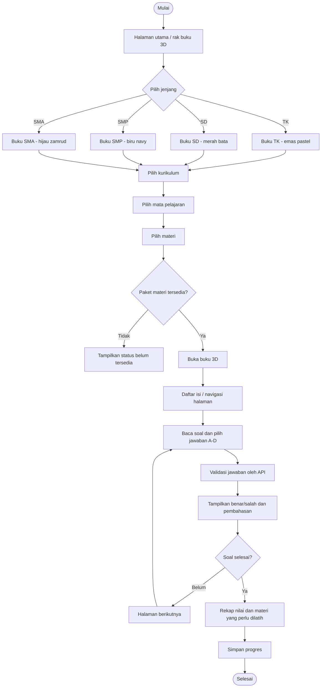
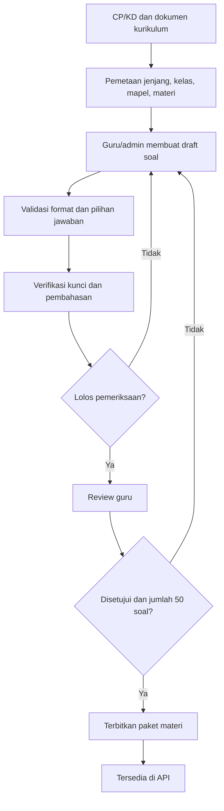
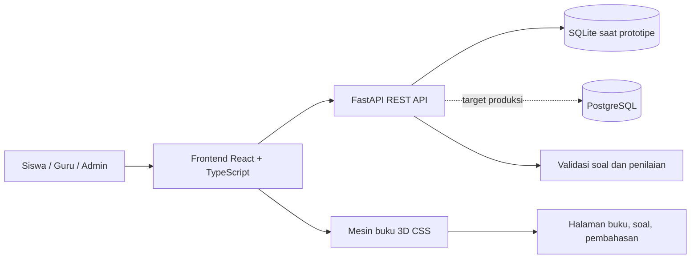
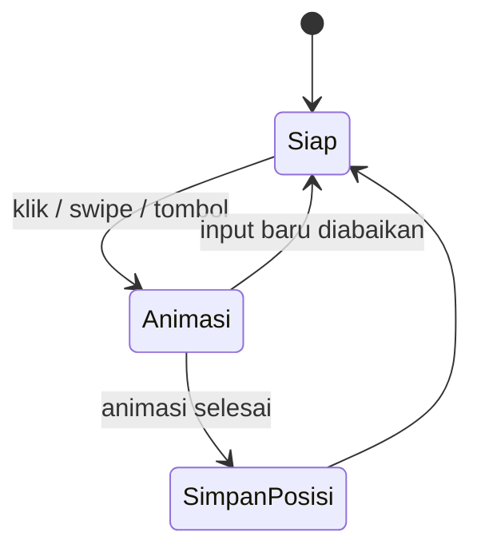

# Flowchart Cerdas Cermat 3D

Semua diagram menggunakan Mermaid. Buka file Markdown ini di VS Code dengan ekstensi Mermaid, atau tempel kode diagram ke https://mermaid.live.

## 1. Flowchart utama aplikasi

## 2. Alur produksi konten soal

## 3. Arsitektur sistem

## 4. Siklus membalik halaman

